# 👋 Hey! Nice to see you.

Welcome to my page! I'm Hari, a computer science student at the **University of Rochester** in **Rochester, NY**.

I like taking large, messy piles of images and records and turning them into numbers people can act on. The animation up there is pretty much my whole job description.

[](https://hpa-code.github.io)
[](https://www.linkedin.com/in/hari-p-acharya)

## 🧙 Character sheet

<table>
  <tr><td>🎓 <b>Class</b></td><td>Computer Science, B.S. expected May 2027</td></tr>
  <tr><td>🏆 <b>Hackathons won</b></td><td>3</td></tr>
  <tr><td>🤖 <b>Titles earned</b></td><td>FIRST Robotics Scholar, UWC-Davis Scholar, EDGE Scholar</td></tr>
  <tr><td>🔭 <b>Current guild</b></td><td>Research assistant, Goergen Institute for Data Science &amp; AI</td></tr>
  <tr><td>💡 <b>Favorite magic</b></td><td>Machine learning, computer vision, data engineering</td></tr>
</table>

## 🎒 Inventory

**🗣️ Languages**


**🧠 Machine learning**


**📊 Data**


**☁️ Cloud and DevOps**


**📱 Apps**


## 🗺️ Pick a quest

Click one to open it.

<details open>
<summary><b>🗽 Will this pothole get fixed this week?</b> &nbsp;·&nbsp; NYC 311 Signal</summary>
<br>

A daily pipeline reads New York City's 311 service requests and predicts which new ones won't close within seven days, then puts it all on a live dashboard.

**Loot:** [the code](https://github.com/hpa-code/nyc-311-signal) · [the dashboard](https://hpa-code.github.io/nyc-311-signal/)

</details>

<details>
<summary><b>🌳 How green is a campus, just from looking at it?</b> &nbsp;·&nbsp; Campus sustainability research</summary>
<br>

Spot physical features in street-level and satellite imagery of 5,900+ U.S. campuses, then use them to predict each school's sustainability rating.

**Loot:** [the write-up](https://hpa-code.github.io)

</details>

<details>
<summary><b>🛰️ Draw a shape, get the aerial photos</b> &nbsp;·&nbsp; geoimagery</summary>
<br>

An open-source Python library that downloads NAIP aerial imagery for any polygon through Google Earth Engine and clips it to your shape.

```bash
pip install "geoimagery[all]"
```

**Loot:** [the code](https://github.com/hpa-code/geoimagery) · [PyPI](https://pypi.org/project/geoimagery/)

</details>

<details>
<summary><b>📸 Never retype an event flyer again</b> &nbsp;·&nbsp; Eventuality</summary>
<br>

Built with a team: a mobile app that turns a photo of an event flyer into a calendar-ready event.

**Loot:** [the code](https://github.com/Eventuallity/eventuality-app)

</details>
