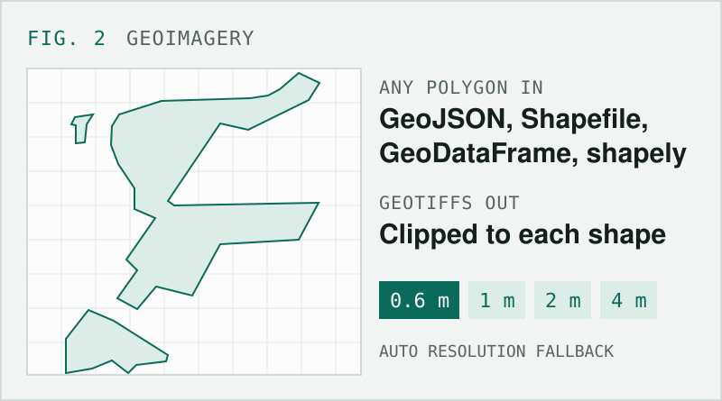
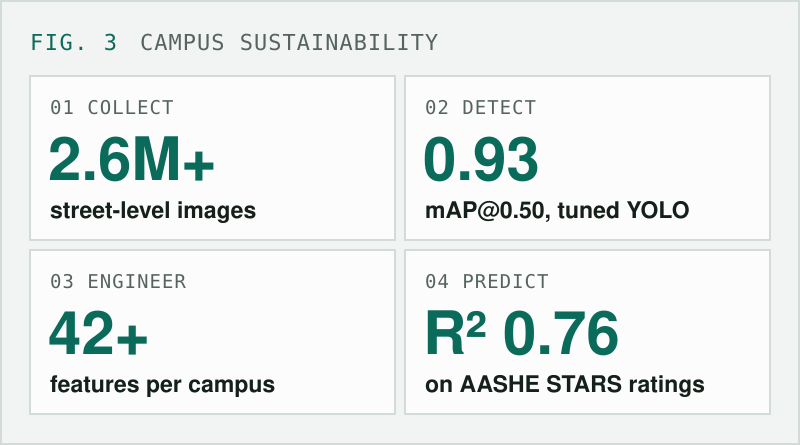
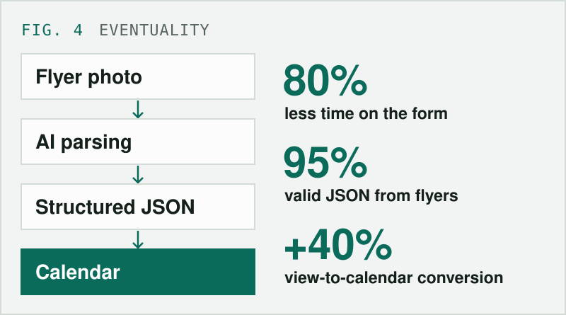

  <a href="https://hpa-code.github.io"><b>Website</b></a> &nbsp;·&nbsp;
  <a href="https://www.linkedin.com/in/hari-p-acharya"><b>LinkedIn</b></a>

### `01` Projects

<table>
  <tr>
    <td width="50%" valign="top">
      
        
      <b><a href="https://github.com/hpa-code/nyc-311-signal">NYC 311 Signal</a></b> · <a href="https://hpa-code.github.io/nyc-311-signal/">live dashboard</a>
       
      A daily AWS and Snowflake pipeline over 6.9M NYC 311 requests, with a model that predicts which new requests won't close within seven days.
    </td>
    <td width="50%" valign="top">
      
        
      <b><a href="https://github.com/hpa-code/geoimagery">geoimagery</a></b> · <a href="https://pypi.org/project/geoimagery/">PyPI</a>
       
      An open-source Python library that downloads NAIP aerial imagery for any polygon through Google Earth Engine.
    </td>
  </tr>
  <tr>
    <td width="50%" valign="top">
      
        
      <b><a href="https://hpa-code.github.io">Campus sustainability from imagery</a></b> · research
       
      Detecting physical features in street-level and satellite imagery of 5,900+ U.S. campuses to predict sustainability ratings.
    </td>
    <td width="50%" valign="top">
      
        
      <b><a href="https://github.com/Eventuallity/eventuality-app">Eventuality</a></b> · mobile app
       
      Built with a team: snap a photo of an event flyer and get a calendar-ready event.
    </td>
  </tr>
</table>

### `02` Experience

| Role | Where | When |
| :--- | :---- | :--- |
| **Research Assistant** | Goergen Institute for Data Science & AI | Feb 2026 to present |
| **Data Science & AI Intern** | Buffalo Solar | Summer 2026 |
| **Software Engineering Intern** | InnoTech | Summer 2025 |

### `03` Toolkit

**Languages** &nbsp; `Python` `SQL` `Java` `C` `Swift` `R` `TypeScript`

**ML and data** &nbsp; `PyTorch` `scikit-learn` `XGBoost` `YOLO` `OpenCV` `Pandas` `Tableau`

**Cloud and tools** &nbsp; `AWS` `Snowflake` `PostgreSQL` `Terraform` `Docker` `Streamlit` `GitHub Actions`

 

Detection boxes in the banner are illustrative, not model output.
